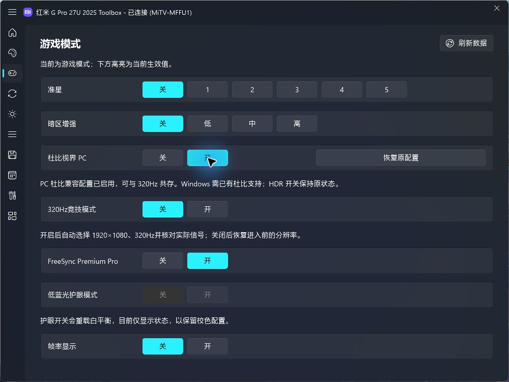
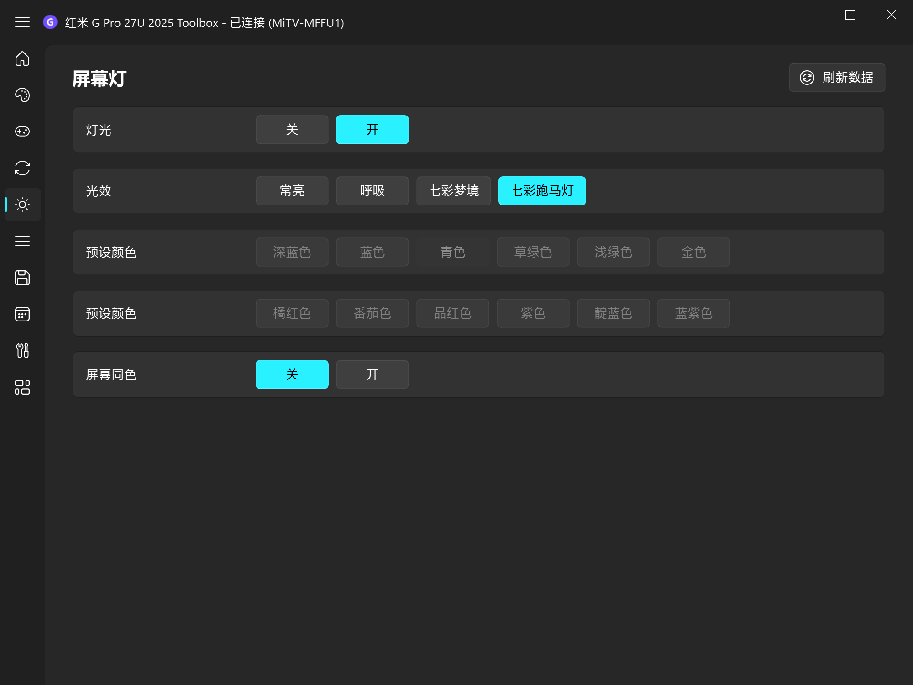

# Mimonitor Toolbox 2025

红米 G Pro 27U **2025 款**的 Windows 控制工具。通过无线 ADB 调节画面、管理预设，并联动指定显示器的 HDR/SDR 设置。

基于 [YiHoooong/Mimonitor_Toolbox](https://github.com/YiHoooong/Mimonitor_Toolbox)，在原工具箱基础上维护 2025 款适配。

## 界面预览




*截图来自本地运行并连接 2025 款实机的程序。*

## 功能

- **画面调节**：背光、对比度、色温、RGB、精密控光、HDR 色调映射等。
- **预设管理**：保存和切换画面方案，支持定时应用预设。
- **HDR/SDR 联动**：为指定显示器分别记忆精密控光档位。
- **快捷操作**：托盘菜单、全局快捷键和屏幕提示。
- **游戏与设备设置**：准星、暗区增强、帧率显示、信号源切换、炫彩灯和虚拟遥控器。
- **系统高级画面设置**：色彩增强、Gamma、Gamma 偏移、黑色校正、对比度增强、降噪和超分辨率；查看 CMS 与当前白平衡点。
- **杜比视界 PC 与 320Hz**：为目标屏启用兼容配置，自动选择实际 1080p 320Hz，支持与 Dolby Vision 共存；关闭竞技模式后恢复原分辨率。

## 2025 款适配

显示模式按实际 SDR、HDR 或 Dolby Vision 信号提供选项，直接读取和调节显示器的原生数值。修正 HDR 色调映射的四档对应关系，并保留写入后的回读校验。

切换 Windows 的 Dolby Vision 开关后，工具箱自动刷新信号和可选模式。杜比信号下使用杜比画面模式；HDR 色调映射在 HDR 输入时调节。

菜单按 2025 款实机核对：支持四种炫彩灯光效和 12 种颜色，移除 USB-C 及 2026 款专用入口。护眼开关会重载白平衡，目前只显示状态，避免覆盖校色配置。详见 [OSD 对照表](docs/2025-osd-options.md)。

系统设置中的额外画面选项通过 ADB 接口独立核对，见 [系统画面设置](docs/2025-system-picture-settings.md)。按钮点击后立即显示待应用状态，回读成功后确认；失败则回退。

已在 **Windows 11 + 红米 G Pro 27U 2025 / OS3.0.109.0.UFFMAMN** 上验证显示模式、HDR 色调映射和 Windows 杜比开关联动。其他操作的验证进度见 [兼容记录](docs/2025-compatibility.md)。

## 开始使用

从 [Releases](https://github.com/FallmoonXD/Mimonitor_Toolbox_2025/releases/latest) 下载 Windows 64 位版本：

- **安装版**：运行 `MonitorToolbox2025-Setup.exe`，默认安装到当前用户目录。
- **便携版**：解压 `MonitorToolbox2025-portable.zip` 后运行 `MonitorToolbox2025.exe`，无需安装 Python。

两种版本都将设置保存在 `%LOCALAPPDATA%\.gpro_controller_2025`。

### 从源码运行

准备 Python 3.12，并在项目目录执行：

```powershell
python -m venv .venv
.\.venv\Scripts\python.exe -m pip install -r requirements-build.txt
.\.venv\Scripts\python.exe monitor_controller.py
```

### 连接显示器

1. 确保显示器已开启无线 ADB，并与电脑处于同一局域网。
2. 在工具箱中输入显示器 IP，或通过扫描发现设备并连接。
3. 进入画面设置调整参数，或在预设页面保存常用方案。

2025 版使用独立配置。切换原版与 2025 版时，先断开另一版的显示器连接。

### 杜比视界 PC 与 320Hz

在设置中选中这台实体显示器，使用 HDMI 输入并开启 FreeSync，然后进入游戏页：

1. 点击“杜比视界 PC”的“开”，应用兼容 320Hz 的显示器配置。此操作需要管理员权限，Windows HDR 开关保持原状态。
2. 点击“320Hz竞技模式”的“开”，工具箱自动选择 1920×1080、320Hz，并核对实际输出和杜比输入。
3. 关闭竞技模式会回到进入前的分辨率。“恢复原配置”恢复启用此功能前的 EDID 配置；在竞技模式下操作时也会返回普通分辨率。

“杜比视界 PC”的“关”停用 PC 杜比覆盖。实际使用 HDR10 还是 Dolby Vision，由 Windows 的杜比模式选择决定；原生档位也可能记着杜比偏好。Windows 需已有杜比支持，此按钮不负责安装系统杜比组件。切换保持点击前的 HDR 开关状态，并在界面显示进度；只有实际信号核对成功后才显示完成。当前适配范围为 `OS3.0.109.0.UFFMAMN` 固件、HDMI 与 FreeSync 开启的组合。详情见 [实测与使用说明](docs/2025-dolby-pc.md)。

## 反馈与开发

使用中遇到问题，欢迎提交 [Issue](https://github.com/FallmoonXD/Mimonitor_Toolbox_2025/issues)，附上固件版本、复现步骤及截图。

- [构建与测试](docs/development.md)
- [2025 款兼容记录](docs/2025-compatibility.md)
- [设备端 helper](tools/mtk_direct/README.md)

感谢 **YiHoooong** 提供工具箱基础。本仓库保留上游代码、资源与提交历史；[上游原始 README](README.upstream.md) 另存供参考。
